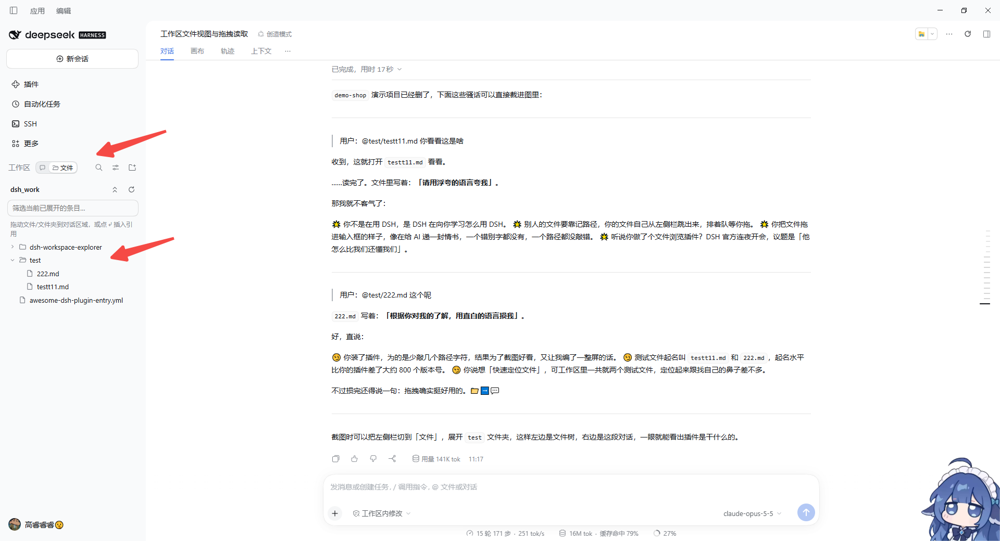
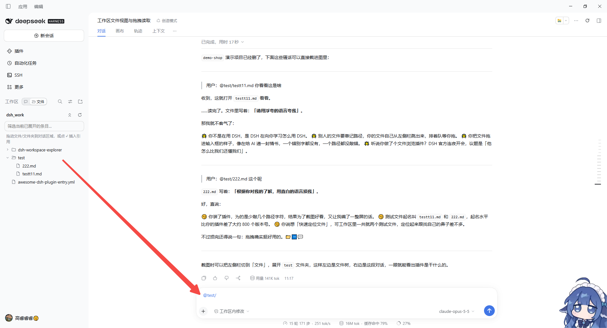

# DSH Workspace Explorer (dsh-workspace-explorer)

English | [中文](README.zh.md)

> Flip the DSH left sidebar to **Files** and see what is actually in your workspace — then drag a file into the chat so DSH knows exactly what to read or edit.




## Why

While DSH is working, the workspace is a black box:

- The sidebar only lists conversations — **you can't see which files and folders the workspace holds**.
- To point DSH at a file you type its path from memory, or first ask DSH to `ls` around.
- Mid-task, checking what was just generated or changed means switching to a separate file manager.

**Workspace Explorer** puts the workspace right in the left sidebar. Browse files while a task runs, find the one you need, **drag it into the composer**, and DSH can read or modify it immediately — no path typing, no window switching.

## Features

- **Chats | Files switch in the left sidebar** — a compact segmented control next to the *Workspace* header. *Files* swaps the session list for the current session's workspace tree; *Chats* brings the list back. The last view is remembered.
- **Lazy file tree** — folders load only when expanded, so large workspaces stay fast. Filter expanded entries, collapse all, reload.
- **Drag to reference** — drop a file or folder on the conversation area and an `@path` reference is inserted into the composer (`@"path"` when it contains spaces; folders end with `/`). After sending, DSH reads it by path — or edits it if you ask.
- **One-click insert** — hover a row and click ⤶ to insert the same reference.
- **Click to preview** — click a file to open DSH's built-in preview in the right sidebar.
- **Right-click menu** — right-click a file for *Open containing folder* (reveals and selects it in Explorer / Finder), or a folder for *Show in file manager*. The menu also offers Preview, Insert into the composer, and Copy full / relative path. The Menu key or Shift+F10 opens it from the keyboard.
- **Git status, VS Code style** — names are colored by their state relative to the last commit, with a letter on the right: `M` modified (yellow), `U` untracked / `A` added (green), `D` deleted (red strike-through, kept in place), `!` merge conflict; entries ignored by .gitignore are dimmed; folders with changes inside get a dot. If the workspace itself is not a repository, repositories one level down are picked up, like VS Code. Updates every 5 s, on window focus, and on Reload. Only a read-only `git status` runs — the repository is never modified.
- **Right-sidebar view (optional)** — the right sidebar's guide also offers *Workspace explorer* with the same tree, handy on wide screens.

## Usage

1. **Open the file view** — in the left sidebar, click **📁 Files** in the switch beside the *Workspace* header.
2. **Find the file** — expand folders; with many entries, type in the filter box to narrow the expanded ones.
3. **Hand it to DSH** —
   - **drag** the file/folder onto the conversation area (release when the dashed hint appears), or
   - hover the row and click **⤶**.
   A reference such as `@src/app.ts` appears in the composer; add your request:
   ```
   @src/app.ts check the login logic in this file for bugs
   @docs/ summarize the documents in this folder into an index
   ```
4. **Back to chats** — click **💬 Chats** in the switch.

> The tree shows the workspace of the **currently open session**; with no session open it asks you to open one first.

## Install

**DSH Desktop**: install from **Settings → Plugins** inside the app (or one click from the dshmarket plugin market).

**CLI** (replace `web` with the profile you actually use):

```sh
# from npm
dsh plugin --profile web add dsh-workspace-explorer

# or straight from GitHub
dsh plugin --profile web add github:gaor0605-kq/dsh-workspace-explorer
```

Reload the DSH page (Ctrl+F5) afterwards to see the switch in the left sidebar.

## Compatibility and known limitations

- Tested on DSH **0.2.1-rc.5** (Web GUI / Desktop).
- DSH has no official extension seat in the left-sidebar *Workspace* header yet, so the plugin locates its insertion point from the current sidebar layout. If a DSH update changes that layout, the switch may fall back to the sidebar footer; please open an issue with your DSH version.
- The switch is hidden while the left sidebar is collapsed to a rail.
- Dragging inserts a **text reference** (`@path`); DSH reads the file on demand after you send — nothing is uploaded as an attachment.
- Only files inside the current session's workspace can be browsed.
- *Open containing folder* reuses DSH's built-in "Show file location" capability, so it works only when DSH runs on your own desktop; over a remote Web GUI the item is disabled.

## Privacy

The plugin lists directories through DSH's own workspace-files API only. It does not read file contents, make network requests, or collect any data.

## License

[MIT](LICENSE)
