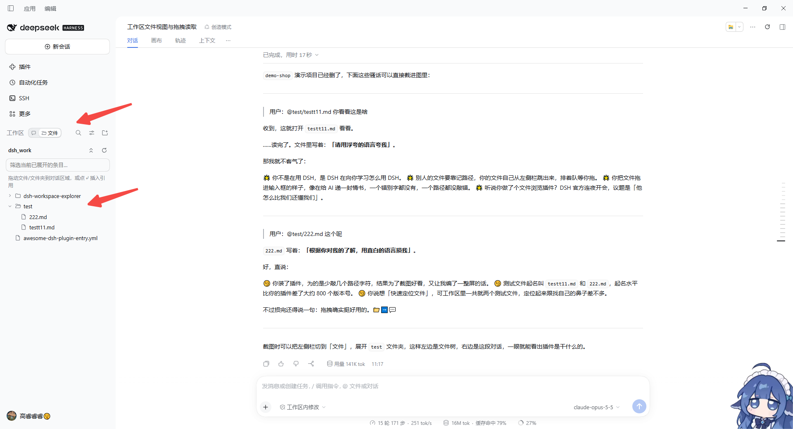
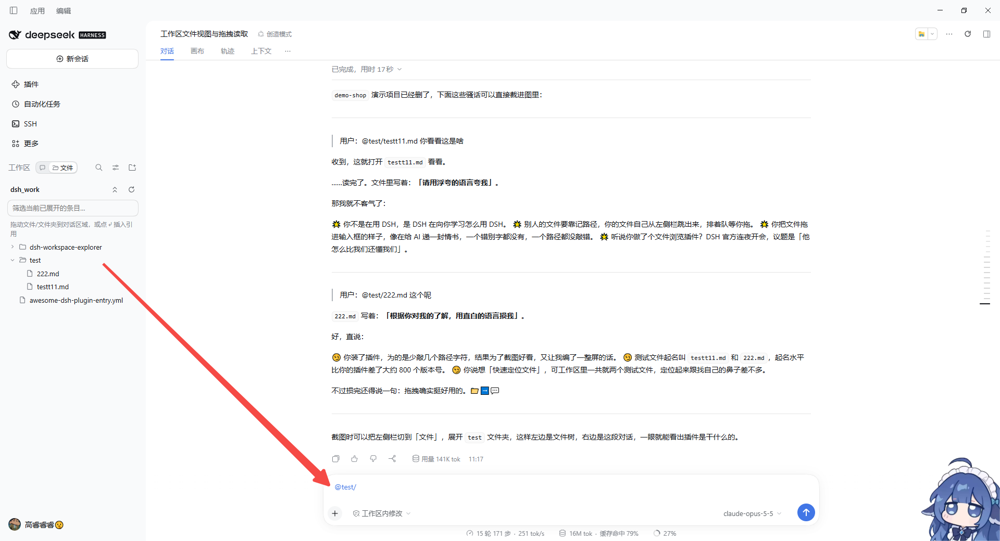

# DSH 工作区浏览器（dsh-workspace-explorer）

[English](README.md) | 中文

> 在 DSH 左侧栏一键切到「文件」，看清工作区里有什么；把文件拖进对话框，DSH 就知道该读哪个、改哪个。




## 为什么做这个插件

用 DSH 干活时，工作区是一个「看不见的盒子」：

- 会话列表里只有对话，**看不到工作区下到底有哪些文件和文件夹**；
- 想让 DSH 处理某个文件，只能凭记忆手敲路径，或者先让 DSH 去 `ls` 一遍再说；
- 任务做到一半，想确认它刚生成了什么、改了哪个文件，还得切到资源管理器里翻。

**工作区浏览器**把工作区直接摆到左侧栏：边执行任务边浏览文件，找到目标后**拖进对话框**，DSH 就能马上读取或修改它——不用记路径，不用来回切窗口。

## 功能

- **左侧栏「对话 | 文件」切换**：在「工作区」标题旁，一个紧凑的分段开关；切到「文件」后，会话列表换成当前会话的工作区文件树，切回「对话」即恢复。上次停留的视图会被记住。
- **按需加载的文件树**：点击文件夹展开 / 折叠，只在展开时读取，大目录也不卡；支持筛选已展开的条目、一键全部折叠、刷新。
- **拖到对话框即引用**：把文件或文件夹拖到对话区域，输入框中会插入 `@路径` 引用（路径含空格时自动写成 `@"路径"`，文件夹以 `/` 结尾）。发送后 DSH 会按路径读取它，你也可以直接让它修改。
- **一键插入**：鼠标悬停在某一行时点 ⤶，同样会把引用插入输入框。
- **单击预览**：单击文件，在右侧栏打开 DSH 自带的文件预览。
- **右键菜单**：右键文件选「打开文件所在文件夹」，会在系统资源管理器 / 访达里定位并选中它；右键文件夹选「在文件管理器中显示」。菜单里还有预览、插入到对话输入框、复制完整路径 / 相对路径。键盘上按菜单键或 Shift+F10 也能打开。
- **右侧栏视图（可选）**：右侧栏的入口卡片里也有「工作区浏览器」，提供同样的文件树，适合宽屏时并排使用。

## 使用方法

1. **打开文件视图**：在左侧栏「工作区」标题右边，点分段开关里的 **📁 文件**。
2. **找文件**：点文件夹逐级展开；文件多时在顶部的筛选框里输入关键字，快速过滤已展开的条目。
3. **交给 DSH**：
   - 把文件 / 文件夹**拖到对话区域**（看到虚线提示框后松开），或
   - 悬停在该行上点 **⤶**。
   输入框里会出现类似 `@src/app.ts` 的引用，再补一句需求，例如：
   ```
   @src/app.ts 帮我看看这个文件里登录逻辑有没有问题
   @docs/ 把这个文件夹下的文档汇总成一份目录
   ```
4. **回到对话**：点分段开关里的 **💬 对话**，切回会话列表。

> 提示：文件树显示的是**当前打开的会话**所在的工作区；还没打开会话时会提示你先打开一个。

## 安装

**DSH 桌面版**：在应用内 **设置 → 插件** 中安装（或通过 dshmarket 插件市场一键安装）。

**命令行**（把 `web` 换成你实际使用的 profile）：

```sh
# 从 npm 安装
dsh plugin --profile web add dsh-workspace-explorer

# 或直接从 GitHub 安装
dsh plugin --profile web add github:gaor0605-kq/dsh-workspace-explorer
```

安装后刷新 DSH 页面（Ctrl+F5）即可看到左侧栏的切换开关。

## 兼容性与已知限制

- 已在 DSH **0.2.1-rc.5**（Web GUI / 桌面版）上测试。
- DSH 目前没有在左侧栏「工作区」标题处提供官方扩展位，插件是根据当前版本的侧边栏界面结构定位插入位置的。若 DSH 升级后界面结构变化，切换开关可能退到侧边栏底部显示；遇到问题请提 issue 并附上 DSH 版本号。
- 左侧栏收起为窄条时不显示切换开关。
- 拖拽插入的是**文本引用**（`@路径`），文件内容由 DSH 在发送后按需读取，不会作为附件上传。
- 只能浏览当前会话工作区内的文件。
- 「打开文件所在文件夹」借用 DSH 自带的“显示文件位置”能力，只在 DSH 运行在本机桌面时可用；远程访问 Web GUI 时这一项会置灰。

## 隐私与安全

插件只通过 DSH 自带的工作区文件接口列出目录，不读取文件内容、不联网、不收集任何数据。

## 许可证

[MIT](LICENSE)
